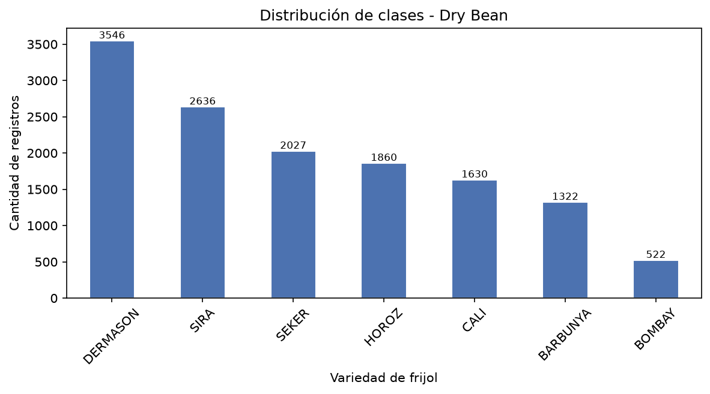
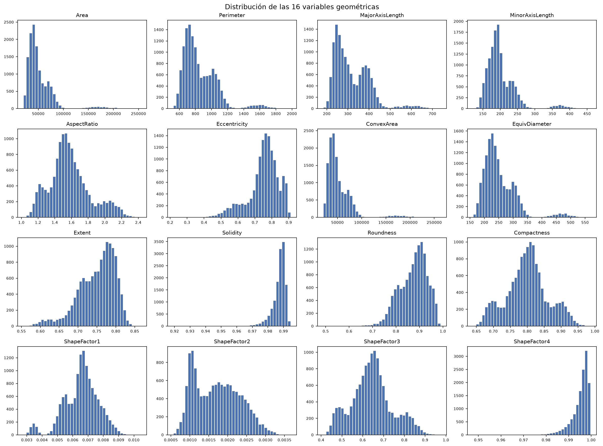
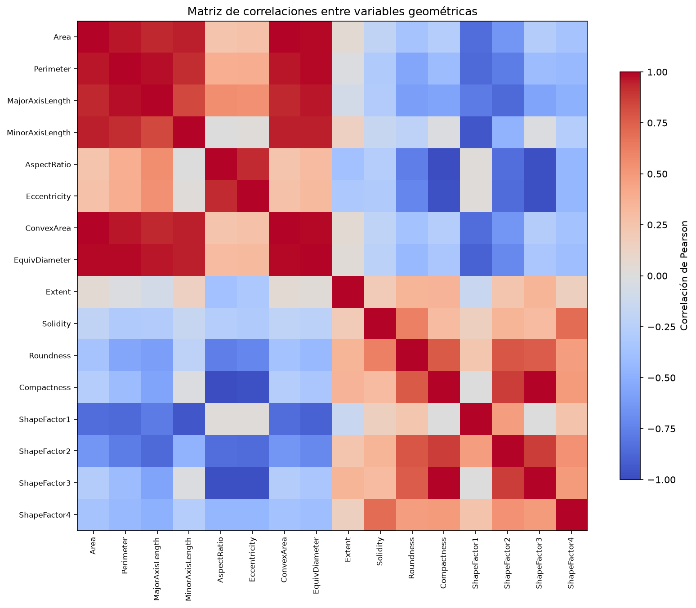
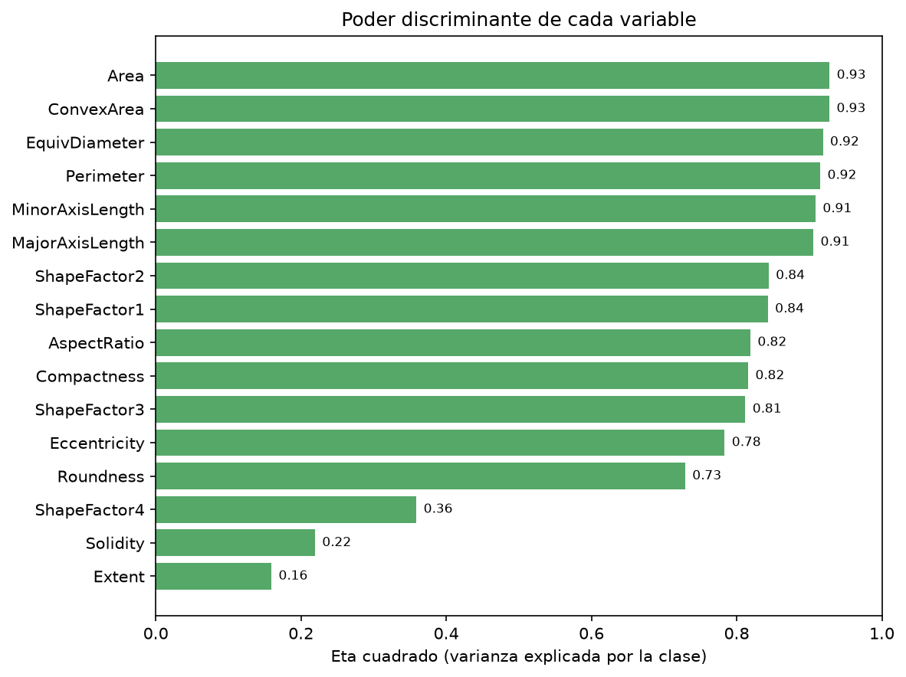
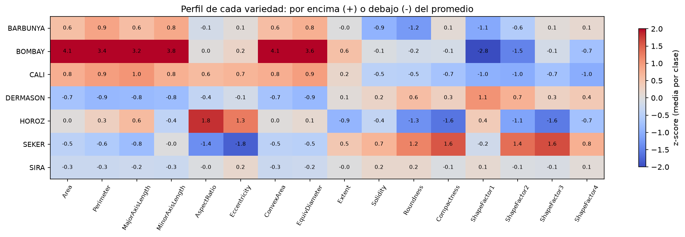
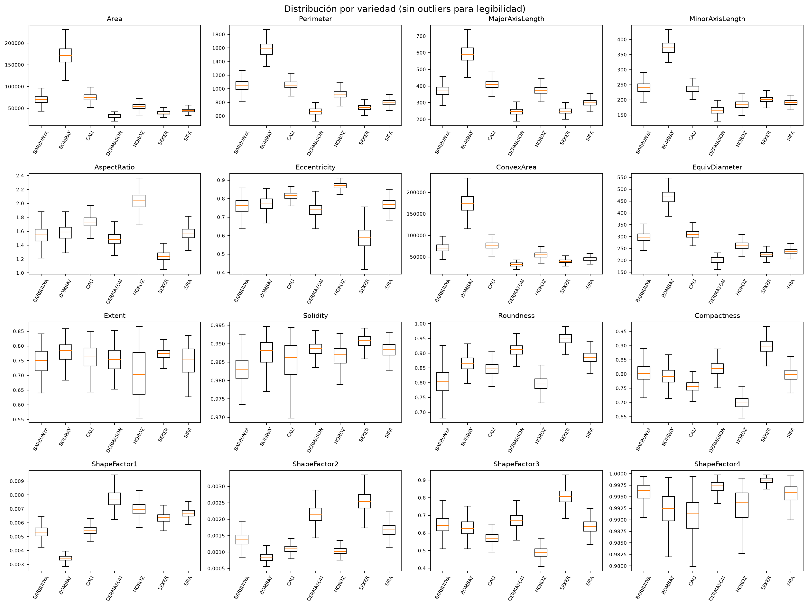

# 02 · Comprensión de los datos

**Fase CRISP-DM 2 — Data Understanding**

## Resumen

| Métrica | Valor |
|---|---:|
| Registros originales | 13 611 |
| Registros tras quitar duplicados | 13 543 |
| Variables | 17 (16 numéricas + `Class`) |
| Clases | 7 |
| Valores nulos | 0 |
| Filas duplicadas | 68 (todas de `HOROZ`) |

El dataset crudo se lee desde `data/bronze/dry_bean.csv`. El EDA completo —perfil numérico,
atípicos, correlaciones, perfiles por clase y separabilidad— queda en esta carpeta como tablas
CSV y gráficas.

## Distribución de clases

| Clase | Registros | % |
|---|---:|---:|
| DERMASON | 3546 | 26.2 % |
| SIRA | 2636 | 19.5 % |
| SEKER | 2027 | 15.0 % |
| HOROZ | 1860 | 13.7 % |
| CALI | 1630 | 12.0 % |
| BARBUNYA | 1322 | 9.8 % |
| BOMBAY | 522 | 3.8 % |

**Desbalance 7:1** entre `DERMASON` y `BOMBAY`: obliga a estratificar y a usar F1 macro.

## EDA 1 — Perfil numérico y valores atípicos

- **Asimetría a la derecha** en las variables de tamaño: `Area` 2.95, `ConvexArea` 2.94,
  `MinorAxisLength` 2.23. La cola la produce `BOMBAY`.
- **Variables casi constantes:** `Solidity` (CV = 0.005) y `ShapeFactor4` (CV = 0.004).
- **Atípicos por IQR:** `Eccentricity` 833 (6.2 %), `Solidity` 774 (5.7 %), `ShapeFactor4` 760
  (5.6 %), `MinorAxisLength` 567 (4.2 %), `Area` 551 (4.1 %).
- **Decisión:** no se eliminan. Son granos reales; borrarlos quitaría la señal de `BOMBAY`.

## EDA 2 — Relaciones entre variables

| Par | Correlación | Interpretación |
|---|---:|---|
| `Area` – `ConvexArea` | 0.9999 | Prácticamente la misma variable |
| `Compactness` – `ShapeFactor3` | 0.9987 | Duplican información de forma |
| `Perimeter` – `EquivDiameter` | 0.9915 | Diámetro y perímetro crecen juntos |
| `AspectRatio` – `Compactness` | −0.9876 | Relación inversa casi perfecta |

Las 16 variables contienen unas **10 dimensiones independientes**. Consecuencias: los
coeficientes de la regresión logística no se interpretan de forma causal y la importancia del
bosque se lee por bloques (tamaño, forma, contorno), no por variable aislada.

## EDA 3 — Separabilidad por clase

| Variable | Eta cuadrado |
|---|---:|
| Area | 0.9279 |
| ConvexArea | 0.9277 |
| EquivDiameter | 0.9187 |
| Perimeter | 0.9151 |
| MinorAxisLength | 0.9086 |
| MajorAxisLength | 0.9056 |
| … | … |
| ShapeFactor4 | 0.3589 |
| Solidity | 0.2192 |
| Extent | 0.1592 |

**Seis variables superan eta² = 0.90.** Son medidas de tamaño y explican por qué el problema es
casi linealmente separable, y por qué la regresión logística empata con el bosque aleatorio.

### Perfil de cada variedad

| Variedad | Rasgo dominante | z-score |
|---|---|---:|
| `BOMBAY` | Mucho más grande que todas | Area +4.1, ConvexArea +4.1 |
| `HOROZ` | Alargada y excéntrica | AspectRatio +1.8, Eccentricity +1.3 |
| `SEKER` | Redonda y compacta | Roundness +1.2, Compactness +1.6 |
| `DERMASON` | Compacta y pequeña | ShapeFactor1 +1.1, Area −0.7 |
| `BARBUNYA` | Contorno poco sólido | Solidity −0.9, ShapeFactor1 −1.1 |
| `SIRA` | **Perfil promedio** | todas entre −0.3 y +0.3 |

`SIRA` no tiene ningún rasgo extremo: se parece al promedio y por eso es la clase más difícil.
El EDA **anticipó** su F1 de 0.87 y su confusión con `DERMASON` antes de entrenar.

## Hallazgos → decisiones

| Hallazgo | Decisión que justifica |
|---|---|
| Colas largas y asimetría | Estandarizar para el modelo lineal; no escalar para árboles |
| Outliers legítimos | Conservarlos: son la señal de `BOMBAY` |
| Multicolinealidad alta | No interpretar coeficientes aislados; agrupar importancia |
| 6 variables con eta² > 0.90 | El baseline competirá con el bosque |
| `SIRA` con perfil promedio | Anticipa su F1 bajo y la confusión con `DERMASON` |
| Variables casi constantes | Candidatas a eliminar en una versión futura |

## Artefactos

| Archivo | Contenido |
|---|---|
| [`perfil_datos.json`](perfil_datos.json) | Resumen de calidad y metadatos del EDA |
| [`perfil_numerico.csv`](perfil_numerico.csv) | Media, dispersión, cuantiles, asimetría, curtosis y CV |
| [`valores_atipicos.csv`](valores_atipicos.csv) | Conteo de atípicos por variable (regla IQR) |
| [`correlaciones_top.csv`](correlaciones_top.csv) | 10 pares con mayor correlación absoluta |
| [`perfiles_por_clase.csv`](perfiles_por_clase.csv) | Media estandarizada de cada variable por clase |
| [`separabilidad_features.csv`](separabilidad_features.csv) | Eta cuadrado por variable |
| `histogramas_variables.png` | Distribución de las 16 variables |
| `matriz_correlaciones.png` | Mapa de calor de correlaciones |
| `perfiles_por_clase.png` | Perfil z-score de las 7 variedades |
| `separabilidad_por_clase.png` | Poder discriminante por variable |
| `boxplots_por_clase.png` | Distribución por variedad |

## Evidencia

- Notebook: sección **2. Comprensión de los datos** (incluye EDA 1–3).
- Reporte: [`docs/reporte_crisp_dm.md`](../docs/reporte_crisp_dm.md), sección 2.
