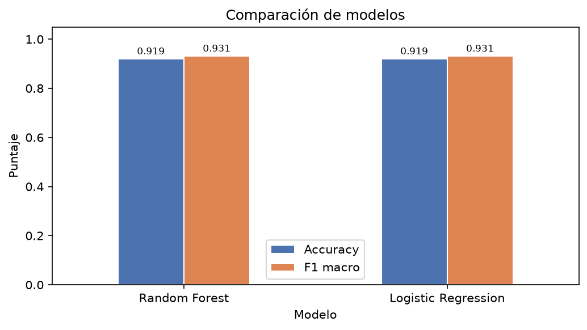
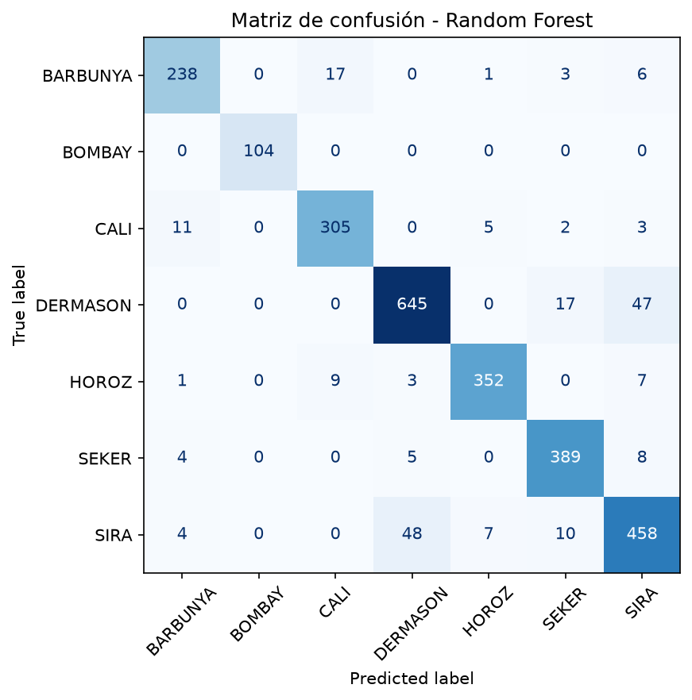

# 05 · Evaluación

**Fase CRISP-DM 5 — Evaluation**

## Comparación de modelos

| Modelo | Accuracy | F1 macro | F1 ponderado | Precisión macro | Recall macro |
|---|---:|---:|---:|---:|---:|
| Logistic Regression | 0.9195 | 0.9306 | 0.9197 | 0.9311 | 0.9303 |
| **Random Forest** | **0.9195** | **0.9310** | 0.9195 | 0.9312 | 0.9310 |

## Decisión

Los modelos quedan prácticamente empatados (Δ F1 macro = 0.0004). El criterio definido prioriza
F1 macro y, ante empate, el modelo más simple. Se selecciona **Random Forest** por tres razones
documentadas: F1 macro ligeramente superior, importancia de variables para explicar el resultado
y mayor robustez ante relaciones no lineales en lotes futuros. El empate técnico se registra como
hallazgo: **las 16 medidas geométricas separan las variedades casi linealmente**.

## Errores por clase

| Confusión | Casos | Explicación |
|---|---:|---|
| SIRA → DERMASON | 48 | Variedades alargadas y de tamaño medio con proporciones similares |
| DERMASON → SIRA | 47 | La misma frontera vista al revés |
| DERMASON → SEKER | 17 | Granos límite que se solapan |
| BARBUNYA → CALI | 17 | Área y tamaño parecidos; cambia el contorno |

`BOMBAY` se clasifica perfectamente (F1 = 1.00) por ser mucho más grande. `SIRA` es la clase con
peor F1 (0.87). Total: **218 errores de 2709 (8.1 %)**.

## Validación cruzada

F1 macro en 3 particiones: **0.9331 · 0.9326 · 0.9316** → media **0.9324 ± 0.0006**. El
resultado no depende de una partición afortunada.

## Artefactos

| Archivo | Contenido |
|---|---|
| [`metricas_modelos.csv`](metricas_modelos.csv) | Tabla comparativa |
| [`classification_report_*.txt`](classification_report_random_forest.txt) | Precisión, recall y F1 por clase |
| [`matriz_confusion_random_forest.png`](matriz_confusion_random_forest.png) | Matriz del modelo final |
| [`matriz_confusion_logistic_regression.png`](matriz_confusion_logistic_regression.png) | Matriz del baseline |
| [`comparacion_modelos.png`](comparacion_modelos.png) | Barras de accuracy y F1 macro |
| [`importancia_variables.png`](importancia_variables.png) | Top 10 de variables |
| [`importancia_variables.csv`](importancia_variables.csv) | Importancias numéricas |
| [`predicciones_drybean.csv`](predicciones_drybean.csv) | Clase real vs. predicha |
| [`resumen_ejecucion.json`](resumen_ejecucion.json) | Trazabilidad completa de la corrida |

## Evidencia

- Notebook: sección **5. Evaluación**.
- Reporte: [`docs/reporte_crisp_dm.md`](../docs/reporte_crisp_dm.md), sección 5.
