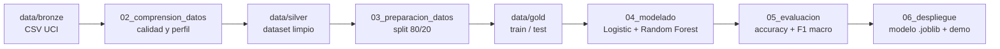

# Clasificación de variedades de frijol seco — Dry Bean ML

[](https://www.python.org/)
[](https://docs.astral.sh/uv/)
[](https://docs.astral.sh/ruff/)
[](https://docs.pytest.org/)
[](LICENSE)

Laboratorio de Machine Learning con datos reales: clasificación de **7 variedades de frijol
seco** a partir de 16 mediciones geométricas, organizado con **CRISP-DM**, **TDSP** y
**Scrum ML**. El proyecto es reproducible de punta a punta: descarga los datos oficiales de UCI,
entrena un baseline y un modelo alternativo, compara métricas, guarda el modelo y deja la evidencia
de cada fase CRISP-DM en su propia carpeta.

## Resultados principales

| Modelo | Accuracy | F1 macro | F1 ponderado |
|---|---:|---:|---:|
| Logistic Regression (baseline) | 0.9195 | 0.9306 | 0.9197 |
| **Random Forest (final)** | **0.9195** | **0.9310** | 0.9195 |

- Dataset: 13 611 registros originales → **13 543** tras eliminar 68 duplicados (todos de `HOROZ`).
- Partición estratificada **80/20**: 10 834 train / 2 709 test, `random_state=42`.
- Validación cruzada (3 particiones) del modelo final: **F1 macro 0.9324 ± 0.0006**.
- Clase perfectamente separada: `BOMBAY` (F1 = 1.00). Clase más difícil: `SIRA` (F1 = 0.87),
  confundida con `DERMASON`.

## Tabla de contenido

- [Problema de negocio](#problema-de-negocio)
- [Dataset](#dataset)
- [Metodologías aplicadas](#metodologías-aplicadas)
- [Estructura del repositorio](#estructura-del-repositorio)
- [Instalación](#instalación)
- [Uso](#uso)
- [Resultados y artefactos](#resultados-y-artefactos)
- [Entregables del laboratorio](#entregables-del-laboratorio)
- [Equipo y roles](#equipo-y-roles)
- [Reproducibilidad](#reproducibilidad)
- [Licencia](#licencia)

## Problema de negocio

Una empresa agrícola clasifica manualmente los granos de frijol que recibe. El proceso es lento,
subjetivo y difícil de auditar. El objetivo es construir un modelo que prediga la variedad
(`Class`) a partir de características geométricas extraídas de imágenes, para **apoyar el control
de calidad** y reducir el tiempo de clasificación manual.

| Elemento | Definición |
|---|---|
| Variable objetivo | `Class` (7 variedades) |
| Tipo de problema | Clasificación multiclase supervisada |
| Métrica principal | F1 macro |
| Criterio de éxito | F1 macro ≥ 0.90 en prueba |
| Uso previsto | Apoyo a la decisión del operario |

## Dataset

**Dry Bean Dataset** — UCI Machine Learning Repository (id 602).
Fuente: <https://archive.ics.uci.edu/dataset/602/dry+bean+dataset>

- 16 variables numéricas: `Area`, `Perimeter`, `MajorAxisLength`, `MinorAxisLength`,
  `AspectRatio`, `Eccentricity`, `ConvexArea`, `EquivDiameter`, `Extent`, `Solidity`,
  `Roundness`, `Compactness`, `ShapeFactor1..4`.
- 7 clases: `BARBUNYA`, `BOMBAY`, `CALI`, `DERMASON`, `HOROZ`, `SEKER`, `SIRA`.
- El CSV original se versiona en `data/bronze/dry_bean.csv` y su SHA-256 queda registrado en
  `03_preparacion_datos/data_manifest.json`.

## Metodologías aplicadas

| Metodología | Cómo se aplica en este repositorio |
|---|---|
| **CRISP-DM** | Seis carpetas (`01_comprension_negocio` … `06_despliegue`), cada una con su README y artefactos, más el notebook y `docs/reporte_crisp_dm.md`. |
| **TDSP** | Estructura `data/notebooks/src/tests`, `src/` reutilizable, manifiesto de datos, semilla fija, métricas y modelos versionables. |
| **Medallón** | Capas de datos `data/bronze` (crudo), `data/silver` (limpio) y `data/gold` (listo para modelar). |
| **Scrum ML** | Roles, product backlog, 3 sprints, tablero, daily y retrospectiva en `docs/scrum_ml.md`. |



## Estructura del repositorio

```text
taller1/
├── 01_comprension_negocio/   # problema, objetivos y criterios de éxito
├── 02_comprension_datos/     # perfil de calidad y distribución de clases
├── 03_preparacion_datos/     # manifiesto y decisiones de limpieza
├── 04_modelado/              # modelos .joblib (baseline y final)
├── 05_evaluacion/            # métricas, matrices y predicciones
├── 06_despliegue/            # demo de predicción
├── data/
│   ├── bronze/               # CSV original de UCI (inmutable)
│   ├── silver/               # dataset limpio y tipado
│   └── gold/                 # train/test listos para modelar
├── notebooks/
│   └── 01_laboratorio_drybean.ipynb   # Entregable 1 (ejecutado)
├── src/taller1/              # código reutilizable
│   ├── config.py             # rutas y parámetros
│   ├── data.py               # descarga, calidad y persistencia
│   ├── features.py           # separación X/y y split estratificado
│   ├── modeling.py           # entrenamiento, evaluación y joblib
│   ├── reporting.py          # gráficas y tablas
│   └── cli.py                # pipeline y predicción por CLI
├── tests/                    # pruebas con pytest
├── docs/                     # reporte CRISP-DM y evidencia Scrum ML
├── Makefile
├── pyproject.toml
└── README.md
```

## Instalación

Requisitos: [uv](https://docs.astral.sh/uv/) y Python 3.13 (uv lo instala si falta).

```bash
git clone <url-del-repositorio>
cd taller1
uv sync
uv run pre-commit install   # opcional: hooks de calidad
```

> El laboratorio propone `python -m venv` + `pip`. Si prefieres ese camino, funciona igual:
> `python -m venv .venv && .venv\Scripts\Activate.ps1` (Windows) y luego
> `pip install -e .` — el paquete declara todas sus dependencias en `pyproject.toml`.

## Uso

```bash
make pipeline      # descarga/carga datos, entrena, evalúa y guarda artefactos
make notebook      # ejecuta el notebook de inicio a fin
make check         # lint + formato + pruebas
make help          # lista todos los comandos
```

Equivalentes sin `make`:

```bash
uv run taller1 pipeline
uv run jupyter nbconvert --to notebook --execute --inplace notebooks/01_laboratorio_drybean.ipynb
uv run pytest
```

Predicción sobre un lote nuevo (mismas 16 columnas):

```bash
uv run taller1 predict --input ruta/al/lote.csv --output 06_despliegue/predicciones_lote.csv
```

## Resultados y artefactos

| Artefacto | Ruta |
|---|---|
| Perfil de calidad | `02_comprension_datos/perfil_datos.json` |
| Distribución de clases | `02_comprension_datos/distribucion_clases.png` |
| Manifiesto del dataset | `03_preparacion_datos/data_manifest.json` |
| Splits listos para modelar | `data/gold/train.csv`, `data/gold/test.csv` |
| Modelo final | `04_modelado/random_forest_drybean.joblib` |
| Comparación de modelos | `05_evaluacion/metricas_modelos.csv` |
| Reporte por clase (texto) | `05_evaluacion/classification_report_*.txt` |
| Matriz de confusión | `05_evaluacion/matriz_confusion_random_forest.png` |
| Importancia de variables | `05_evaluacion/importancia_variables.{png,csv}` |
| Predicciones de prueba | `05_evaluacion/predicciones_drybean.csv` |
| Resumen de la corrida | `05_evaluacion/resumen_ejecucion.json` |
| Demo de predicción | `06_despliegue/ejemplo_prediccion.json` |

**Interpretación breve:** las 16 medidas geométricas separan las variedades casi linealmente
(la regresión logística queda a 0.0004 de F1 macro del bosque aleatorio). Los errores se
concentran entre variedades de forma y tamaño parecidos — `SIRA` ↔ `DERMASON` y
`BARBUNYA` ↔ `CALI` —, mientras que `BOMBAY`, mucho más grande, se clasifica sin error.

## Entregables del laboratorio

| Entregable | Documento |
|---|---|
| 1. Notebook ejecutado | [`notebooks/01_laboratorio_drybean.ipynb`](notebooks/01_laboratorio_drybean.ipynb) |
| 2. Reporte breve CRISP-DM | [`docs/reporte_crisp_dm.md`](docs/reporte_crisp_dm.md) |
| 3. Evidencia Scrum ML | [`docs/scrum_ml.md`](docs/scrum_ml.md) |
| Anexo. Respuestas de reflexión | [`docs/respuestas_reflexion.md`](docs/respuestas_reflexion.md) |

### Evidencia por fase CRISP-DM

| Fase | Carpeta | Qué contiene |
|---|---|---|
| 1. Comprensión del negocio | [`01_comprension_negocio/`](01_comprension_negocio/README.md) | Problema, objetivos, criterios de éxito, interesados |
| 2. Comprensión de datos | [`02_comprension_datos/`](02_comprension_datos/README.md) | Perfil de calidad, nulos, duplicados, distribución |
| 3. Preparación | [`03_preparacion_datos/`](03_preparacion_datos/README.md) | Limpieza, split, manifiesto y capas de datos |
| 4. Modelado | [`04_modelado/`](04_modelado/README.md) | Baseline y modelo final serializados |
| 5. Evaluación | [`05_evaluacion/`](05_evaluacion/README.md) | Métricas, matrices, importancia y predicciones |
| 6. Despliegue | [`06_despliegue/`](06_despliegue/README.md) | Demo, carga del modelo y checklist de producción |

## Equipo y roles

| Integrante | Rol Scrum ML | Responsabilidad principal |
|---|---|---|
| Alejandro Meneses | Product Owner | Valor del modelo, priorización del backlog, criterios de aceptación |
| Henry Rosenstiehl | Scrum Master + Data Engineer/Analyst | Proceso, tablero, calidad y preparación de datos |
| Marko David García | ML Engineer | Modelado, evaluación y despliegue |

Con tres integrantes, los cuatro roles del plan se cubren combinando Scrum Master y Data
Engineer en una misma persona. La decisión y su justificación están en
[`docs/scrum_ml.md`](docs/scrum_ml.md).

## Reproducibilidad

- Semilla global `random_state=42` en partición y modelos.
- Hash SHA-256 del dataset original en `03_preparacion_datos/data_manifest.json`.
- Versiones exactas de dependencias en `uv.lock`.
- Entorno de ejecución registrado en `05_evaluacion/resumen_ejecucion.json`
  (Python 3.13.2, pandas 3.1.1, scikit-learn 1.9.1).
- Pruebas automatizadas que cubren datos, partición, entrenamiento, evaluación y persistencia.

## Licencia

Distribuido bajo licencia [MIT](LICENSE).
