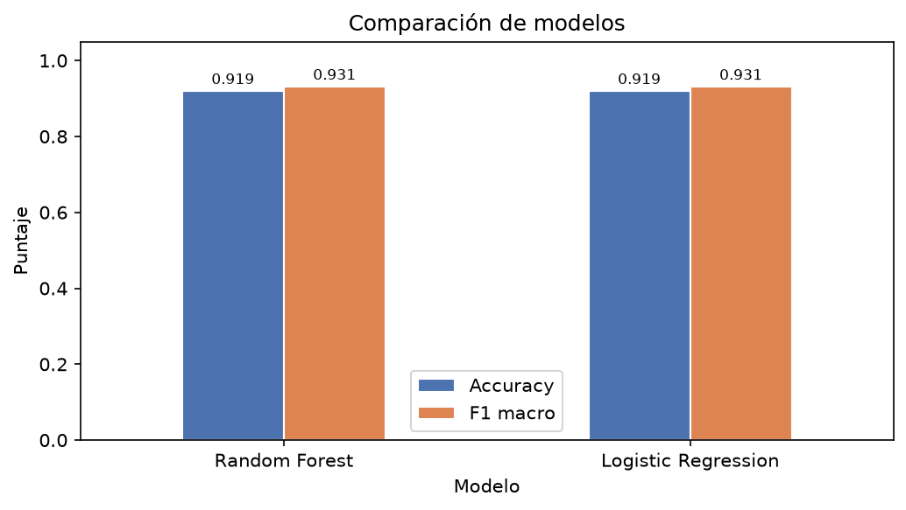
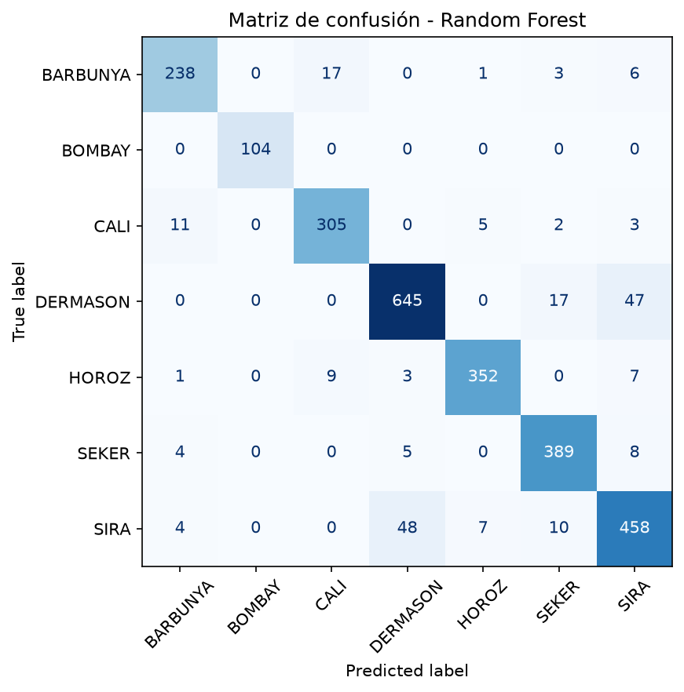
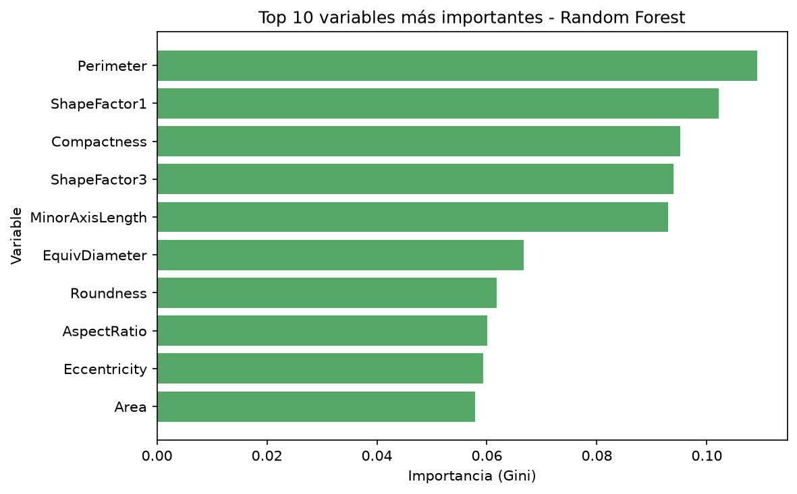

# Reporte CRISP-DM — Clasificación de variedades de frijol seco

**Proyecto:** Laboratorio Dry Bean ML
**Equipo:** Marko David García · Alejandro Meneses · Henry Rosenstiehl
**Curso:** Gerencia de Proyectos — UAO
**Entregable:** 2 de 3 — Reporte breve
**Notebook de respaldo:** [`notebooks/01_laboratorio_drybean.ipynb`](../notebooks/01_laboratorio_drybean.ipynb)

---

## 1. Comprensión del negocio

Una empresa agrícola recibe lotes de frijol seco y debe clasificarlos por variedad antes de
comercializarlos. Hoy parte del proceso es manual: un operario observa el grano y decide su
categoría. El método es lento, subjetivo y difícil de auditar; dos operarios pueden etiquetar el
mismo grano de forma distinta, y el error se descubre tarde, cuando el lote ya está empacado.

**Objetivo.** Construir un modelo que prediga la variedad de frijol (`Class`) a partir de 16
mediciones geométricas extraídas de imágenes, para apoyar el control de calidad y reducir el
tiempo de clasificación manual.

| Elemento | Definición |
|---|---|
| Tipo de problema | Clasificación multiclase supervisada |
| Variable objetivo | `Class` — 7 variedades |
| Métrica principal | F1 macro (todas las clases pesan igual) |
| Métrica secundaria | Accuracy y F1 ponderado |
| Criterio de éxito | F1 macro ≥ 0.90 en el conjunto de prueba |
| Uso previsto | Apoyo a la decisión: el operario confirma o corrige |
| Riesgo principal | Confundir variedades de forma y tamaño similares |

**Por qué F1 macro y no solo accuracy.** `DERMASON` concentra el 26.2 % de los registros y
`BOMBAY` apenas el 3.8 %. Un modelo que ignore la clase minoritaria puede mostrar una accuracy
alta y, aun así, fallar en el control de calidad. El F1 macro promedia el F1 de las siete clases
sin ponderar por frecuencia y hace visible ese fallo.

---

## 2. Comprensión de los datos

**Fuente:** Dry Bean Dataset, UCI ML Repository (id 602),
<https://archive.ics.uci.edu/dataset/602/dry+bean+dataset>. El CSV se descarga del repositorio
oficial y se guarda sin modificar en `data/bronze/dry_bean.csv`; su SHA-256
(`c91a086b…8fcb`) queda registrado en `03_preparacion_datos/data_manifest.json`.

### Tamaño y variables

| Métrica | Valor |
|---|---:|
| Registros originales | 13 611 |
| Variables | 17 (16 numéricas + `Class`) |
| Clases | 7 |
| Valores nulos | 0 |
| Filas duplicadas | 68 |

Las 16 predictoras describen tamaño (`Area`, `Perimeter`, `MajorAxisLength`,
`MinorAxisLength`, `ConvexArea`, `EquivDiameter`), forma (`AspectRatio`, `Eccentricity`,
`Compactness`, `ShapeFactor1..4`) y estructura del contorno (`Extent`, `Solidity`,
`Roundness`). No hay columnas no numéricas aparte de la clase.

### Calidad de los datos

- **Nulos:** 0 en todas las columnas. No se requiere imputación.
- **Duplicados:** 68 filas idénticas, **todas de la clase `HOROZ`**. Se eliminan porque un
  registro repetido sesga el entrenamiento y la evaluación (el modelo "memoriza" una observación
  que aparece dos veces).
- **Valores extremos:** los máximos de `Area`, `Perimeter` y `ConvexArea` corresponden a granos
  grandes de la variedad `BOMBAY`, no a errores de captura. Se conservan.

### Distribución de clases (dataset limpio)

| Clase | Registros | % |
|---|---:|---:|
| DERMASON | 3546 | 26.2 % |
| SIRA | 2636 | 19.5 % |
| SEKER | 2027 | 15.0 % |
| HOROZ | 1860 | 13.7 % |
| CALI | 1630 | 12.0 % |
| BARBUNYA | 1322 | 9.8 % |
| BOMBAY | 522 | 3.8 % |

**Conclusión de la fase:** el dataset es limpio y consistente, pero **desbalanceado**: la clase
mayoritaria tiene casi 7 veces más ejemplos que la minoritaria. Esto condiciona la elección de
métricas y de la estrategia de partición.

---

## 3. Preparación de los datos

| Decisión | Justificación |
|---|---|
| Eliminar 68 duplicados | Evitar observaciones repetidas; todos pertenecen a `HOROZ` |
| Conservar valores extremos | Son granos reales; recortarlos perdería información de `BOMBAY` |
| No imputar | No hay valores faltantes |
| Estratificar el split | Mantiene la proporción de las 7 clases en train y test |
| `random_state=42` | Reproducibilidad exigida por TDSP |
| Estandarizar solo para el modelo lineal | `StandardScaler` dentro del `Pipeline`, ajustado solo con train |
| No escalar para Random Forest | Los árboles comparan umbrales; la escala no altera el orden |

**Partición:** 80/20 estratificada → **10 834** registros de entrenamiento y **2 709** de prueba.
La proporción de cada clase en prueba coincide con la del dataset completo (por ejemplo,
`DERMASON` 26.2 % y `BOMBAY` 3.8 %).

El dataset limpio se guarda en `data/silver/dry_bean_clean.csv` para trazabilidad.

---

## 4. Modelado

### 4.1 Baseline — Regresión logística

`Pipeline(StandardScaler → LogisticRegression(max_iter=1000))`. Se elige como baseline porque es
simple, rápido e interpretable: sirve de vara de medir. Si un modelo complejo no lo supera, no
se justifica su costo.

### 4.2 Modelo alternativo — Random Forest

`RandomForestClassifier(n_estimators=200, class_weight="balanced")`. Captura relaciones no
lineales e interacciones entre medidas de forma y tamaño; el peso balanceado compensa el
desbalance entre variedades. No requiere escalamiento.

---

## 5. Evaluación

### 5.1 Comparación de modelos

| Modelo | Accuracy | F1 macro | F1 ponderado | Precisión macro | Recall macro |
|---|---:|---:|---:|---:|---:|
| Logistic Regression | 0.9195 | 0.9306 | 0.9197 | 0.9311 | 0.9303 |
| **Random Forest** | **0.9195** | **0.9310** | 0.9195 | 0.9312 | 0.9310 |

**Lectura:** los dos modelos quedan prácticamente empatados (diferencia de 0.0004 en F1 macro).
Esto indica que **las 16 medidas geométricas separan las variedades casi linealmente** y que la
complejidad adicional del bosque aporta poco en desempeño.

**Decisión CRISP-DM.** El criterio definido prioriza F1 macro y, ante empate, el modelo más
simple. Con ese criterio la regresión logística sería defendible. Se selecciona **Random Forest**
por tres razones documentadas: (1) F1 macro ligeramente superior, (2) importancia de variables
para explicar el resultado al negocio, (3) mayor robustez ante relaciones no lineales en lotes
futuros. La decisión se revisó con el Product Owner; el empate técnico queda registrado como
hallazgo, no como problema.

### 5.2 Desempeño por clase (Random Forest)

| Clase | Precisión | Recall | F1 | Soporte |
|---|---:|---:|---:|---:|
| BARBUNYA | 0.92 | 0.90 | 0.91 | 265 |
| BOMBAY | 1.00 | 1.00 | 1.00 | 104 |
| CALI | 0.92 | 0.94 | 0.93 | 326 |
| DERMASON | 0.92 | 0.91 | 0.91 | 709 |
| HOROZ | 0.96 | 0.95 | 0.96 | 372 |
| SEKER | 0.92 | 0.96 | 0.94 | 406 |
| SIRA | 0.87 | 0.87 | 0.87 | 527 |

### 5.3 Matriz de confusión

**218 errores de 2709 predicciones (8.1 %).** Las confusiones más frecuentes:

| Confusión | Casos | Explicación basada en variables de forma/tamaño |
|---|---:|---|
| SIRA → DERMASON | 48 | Ambas alargadas y de tamaño medio; proporciones de eje y compacidad parecidas |
| DERMASON → SIRA | 47 | La misma frontera vista al revés |
| DERMASON → SEKER | 17 | SEKER es más redondeada, pero los granos límite se solapan |
| BARBUNYA → CALI | 17 | Área y tamaño similares; cambia la forma del contorno |
| CALI → BARBUNYA | 11 | Misma frontera |

`BOMBAY` se clasifica perfectamente (F1 = 1.00) porque es mucho más grande: `Area` y
`Perimeter` la separan sin ambigüedad. `SIRA` es la clase con peor F1 (0.87), coherente con ser
la que más se confunde con `DERMASON`.

### 5.4 Importancia de variables

| Variable | Importancia |
|---|---:|
| Perimeter | 0.1092 |
| ShapeFactor1 | 0.1021 |
| Compactness | 0.0952 |
| ShapeFactor3 | 0.0939 |
| MinorAxisLength | 0.0929 |

Las variables de contorno y proporción dominan la decisión, lo que es coherente con el problema.
La importancia **no prueba causalidad**: solo indica qué variables usó el modelo para separar
clases.

### 5.5 Validación cruzada (extensión opcional A)

Validación cruzada de 3 particiones sobre el conjunto de entrenamiento:

| Partición | F1 macro |
|---|---:|
| 1 | 0.9331 |
| 2 | 0.9326 |
| 3 | 0.9316 |
| **Media ± desviación** | **0.9324 ± 0.0006** |

La desviación es mínima: el desempeño **no depende de una partición afortunada**. Esa
estabilidad es el argumento técnico para pasar a despliegue.

---

## 6. Despliegue

El despliegue de este laboratorio es una **demo local reproducible**:

1. El modelo final se serializa con `joblib` en
   `04_modelado/random_forest_drybean.joblib`.
2. Se vuelve a cargar desde disco y se verifica con una muestra de prueba
   (`SEKER` predicho, `SEKER` real).
3. La función `predict_bean_class(model, input_data)` encapsula el uso del modelo.
4. La CLI `taller1 predict --input lote.csv` permite clasificar un lote completo.
5. Las predicciones del conjunto de prueba se exportan a
   `05_evaluacion/predicciones_drybean.csv` (clase real vs. predicha) para auditoría.

**Qué faltaría para producción:** validar con imágenes reales de la empresa, definir el costo de
cada tipo de error, monitorear deriva de datos (cámara, iluminación, calibración), versionar el
modelo y exponerlo como servicio con registro de predicciones.

---

## 7. Scrum ML: backlog, sprint review y retrospectiva

La evidencia completa está en [`docs/scrum_ml.md`](scrum_ml.md). Resumen:

| Sprint | Objetivo | Entregable verificado |
|---|---|---|
| Sprint 1 | Comprensión y preparación | Dataset cargado, EDA, split, pipeline de preprocesamiento |
| Sprint 2 | Modelado y evaluación | Baseline, Random Forest, comparación de métricas, matriz de confusión |
| Sprint 3 | Despliegue y documentación | Modelo `.joblib`, README, reporte y demo de predicción |

**Sprint review (cierre):** se aceptaron los 6 ítems del backlog; el criterio de éxito
(F1 macro ≥ 0.90) se cumplió con margen.

**Retrospectiva — qué funcionó:** la estructura TDSP evitó reprocesos y el baseline permitió
detectar temprano que el problema era casi lineal.
**Qué no funcionó:** la descarga con `ucimlrepo` falló por un certificado TLS desactualizado del
sistema; se resolvió descargando con validación `certifi` y dejando el CSV versionado.
**Qué mejoraríamos:** congelar el entorno desde el primer día (lo hicimos con `uv` a mitad del
sprint) y acordar la métrica principal antes de entrenar, no después.

---

## Conclusiones

1. El objetivo de negocio se cumplió: **F1 macro 0.931** y **accuracy 0.9195**, por encima del
   criterio de éxito (≥ 0.90).
2. Las medidas geométricas son suficientes para separar casi linealmente las variedades; el
   bosque aleatorio aporta una mejora marginal (0.0004) frente al baseline.
3. El desbalance se gestionó con estratificación, `class_weight="balanced"` y F1 macro como
   métrica principal.
4. Los errores se concentran entre variedades similares (`SIRA` ↔ `DERMASON`,
   `BARBUNYA` ↔ `CALI`), lo que sugiere incorporar color o textura para reducirlos.
5. La reproducibilidad quedó garantizada: semilla fija, hash del dataset, `uv.lock`, pruebas
   automatizadas y artefactos en las carpetas de cada fase.

### Limitaciones

- El dataset es académico y las imágenes fueron capturadas en condiciones controladas; el
  desempeño en planta puede ser menor.
- El modelo se evaluó con una sola partición principal; la validación cruzada confirma
  estabilidad, pero no sustituye una validación temporal con lotes reales.
- No se exploraron modelos no lineales más sofisticados (SVM, boosting) ni búsqueda de
  hiperparámetros; el margen disponible era pequeño.
